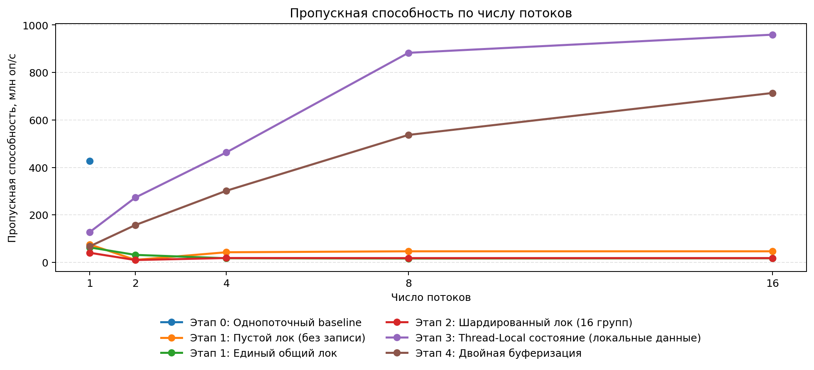

#### 1. Характеристики тестового стенда
- **Процессор (CPU):** *Intel(R) Core(TM) i9-9880H CPU @ 2.30GHz*
- **Число логических процессоров (`nproc`):** *16*
- **Язык и версия:** *openjdk 26.0.2.1*

#### 2. Замеры пропускной способности (млн оп/сек)

| Число потоков (T) | 1 поток | 2 потока | 4 потока | 8 потоков | 16 потоков |
| :--- | :---: | :---: | :---: | :---: | :---: |
| **Этап 0:** Однопоточный baseline |4.26887647E8| — | — | — | — |
| **Этап 1:** Пустой лок (без записи) |7.5299735E7 | 1.0399612E7 | 4.2608908E7 | 4.6612286E7| 4.6610515E7 |
| **Этап 1:** Единый общий лок |6.3001693E7 |3.1555613E7 | 1.7378024E7| 1.6278369E7 | 1.7365677E7|
| **Этап 2:** Шардированный лок (16 групп) |4.0395237E7 | 9842376.0 | 1.8329098E7 | 1.7945028E7|1.7928577E7 |
| **Этап 3:** Thread-Local состояние (локальные данные) | 1.27822572E8 | 2.73014575E8 | 4.63308806E8|8.82854294E8 | 8.58463334E8|
| **Этап 4:** Двойная буферизация | 6.7663518E7| 1.57163687E8|3.01703911E8 | 5.36885562E8 | 7.20862583E8|
 

#### 3. Результаты стресс-теста согласованности снимков
*10 000 вызовов `snapshot()` на фоне 4 пишущих потоков:*

| Реализация | Доля битых снимков (sum != count) | Снимок: sum < count | Снимок: sum > count | Итоговый count − число вызовов (после join) |
| :--- | :---: | :---: | :---: | :---: |
| **Этап 2:** Шардированный лок | 83,43% | 7432 раз | 911 раз | 0 |
| **Этап 3:** Thread-Local состояние (локальные данные) | 99,99% | 9999раз | 0 раз | 0|
| **Этап 4:** Двойная буферизация | 0,00% | 0 раз | 0 раз | 0 |
| **Этап 4 (без шага 3):** без проверки `active` | 94,25% | 1962 раз | 7463 раз | -179 |

#### 4. Короткие ответы на вопросы (1–2 предложения прямо в таблице)

| Вопрос | Ваш ответ |
| :--- | :--- |
| **1. Пустой лок против полного:** Почему пустой лок тоже резко падает с ростом потоков? Что добавляет полная версия? | Потоки постоянно конкурируют за мьютекс и передают владение, а в полной верссии еще появляется перекладывание кэша и общая память|
| **2. Провал шардирования и атомиков:** Почему 16 шардов и атомарная сводка на этапе 2 не спасли скорость записи на законе Ципфа? Куда переехало узкое место? | По закону Ципфа `values` густо распространены около 0го бакета, от чего там появляется горячий мьютекс + дополнительные издержки на атомики(все потоки хотят в них ходить). |
| **3. Замедление на этапе 3:** Почему на этапе 3 рост скорости замедляется после 8 потоков? Как это связано с выводом `lscpu`? | У процессора 2 типа ядер - энергоэффективные и производительные, после 8 потоков начинают использоваться энергоэффективные ядра, а они выполняют меньше операций в секунду.|
| **4. Двойная буферизация против TLS:** Почему этап 4 медленнее этапа 3 (в C++ в 2,5–3,5 раза, в Java в 1,1–1,7 раза, а на 16 потоках Java почти догоняет этап 3), но масштабируется почти линейно? В чём разница инструкций при записи? | Этап 4 медленнее 3го, т.к. требует работы с общим `active` и `seg_cst` запись в `inside`(в 3м каждый поток работает со своим состоянием) + может быть небходимо несколько раз пытаться попасть в буффер. Однако это позволяет получать согласованный `snapshot`. Масштабирование может быть похожим на линейное из-за отсуствие конкуренции за общую структуру записи, единственная синхронизация - проверка `active` и `inside`|
| **5. Эксперимент с шагом 3:** Что сломалось в тесте на этапе 4, когда вы убрали повторную проверку `active == b`? Почему итоговый `count` расходится с числом вызовов? | Без проверки поток может продолжать писать в замороженный снапшотом буффер, что приведет к гонке: некоторые записи посчитает несколько раз, а некоторые не посчитает вовсе, из-за чего возникнет расхождение `count` с числом вызовов.|
